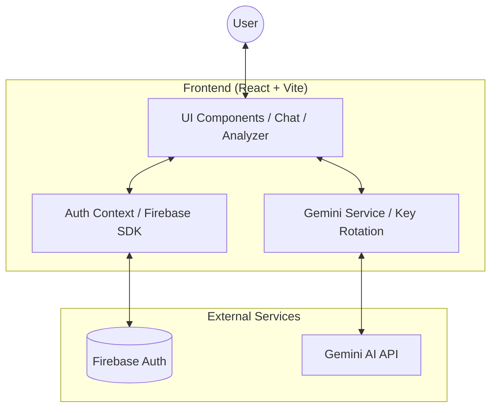
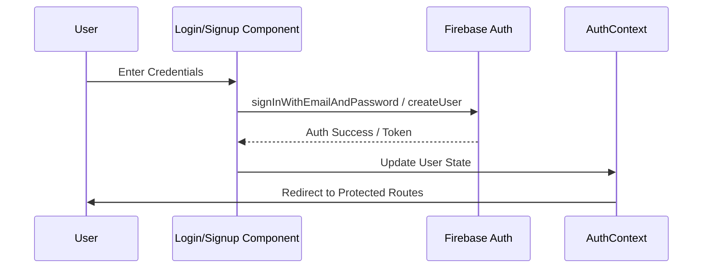
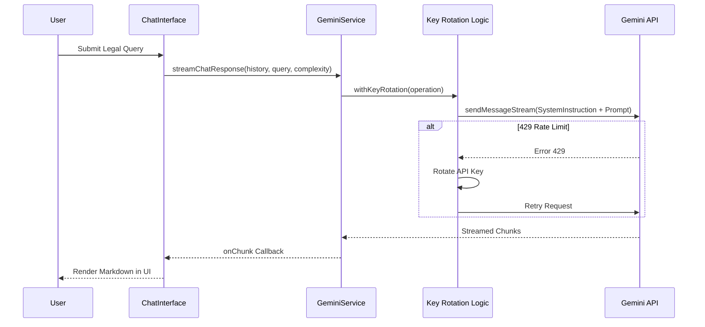
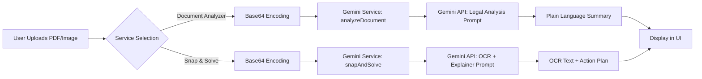

# Legal AI Workflow Diagram

This document illustrates the end-to-end architecture and operational workflows of the Legal AI platform.

## 1. High-Level Architecture

---

## 2. User Authentication Workflow

---

## 3. AI Chat & Reasoning Workflow

---

## 4. Document Analysis & Snap & Solve Workflow

---

## 5. System Features Summary

- **AI Reasoning**: Powered by `gemini-3-flash-preview` with multi-key failover.
- **Multilingual**: Supports 11 Indian languages via dynamic prompt injection.
- **Complexity Control**: Standard, ELI5 (Simple), and Professional modes.
- **Legal Context**: Injects specific instructions for IPC, BNS, and Constitution references.
